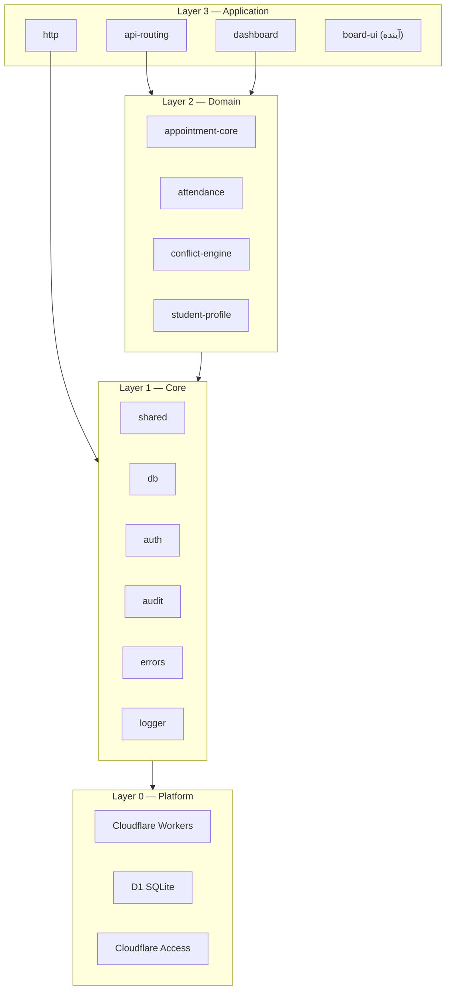
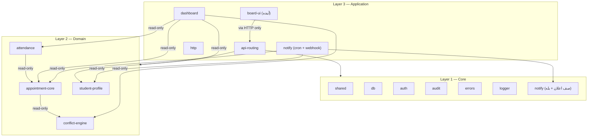

# سند معماری سامانهٔ مرکز جامع سنجش و اختلالات یادگیری

> **ساختار انتشار (دولایه):**
> - **`worker/bundle.js`** (۲.۳MB) — باندل بک‌اند استقراری؛ همان چیزی که روی Cloudflare اجرا می‌شود.
> - **`worker/entry.js`** — نقطهٔ ورود نشر (`main` در wrangler.toml): فقط مسیرهای `/api/scoring/*` را به لایهٔ امتیاز می‌دهد و بقیه را بی‌تغییر به باندل می‌سپارد؛ `scheduled` هم عبوری است.
> - **`worker/scoring.js`** — لایهٔ امتیاز سراسری — (فقط-خواندنی، پروجکشن زندهٔ `audit_log` + جدول‌های محتوا، `SCORING_EPOCH`، سقف فعالیت اداری) — تک‌سورس این لایه همین فایل JS است.
> - **`src/`** — سورس TypeScript ماژول‌ها + هارنس تست (`src/test/`) و تست‌های e2e: اعتبار رفتارهای پایدار (حضور، نوبت، پیگیری، فرم‌ساز، تمرین، بات، امتیاز). تایپ‌چک `tsc --noEmit` از **صفر خطا** است و مجموعهٔ تست ۱۰۸۳/۱۰۸۳ سبز.
> - **تغییر رفتار بک‌اند** روی `worker/*.js` اعمال و با مجموعهٔ تست `src/` راستی‌آزمایی می‌شود؛ بخش‌های این سند که الگوها و قراردادهای `src/` را توصیف می‌کنند مرجع طراحی ماژول‌هاست.

> **محدوده این سند:** لایه‌بندی، قرارداد بین ماژول‌ها، و انضباط نوبت‌دهی به‌عنوان اولین ماژول دامنه.
> فیچرهای بعدی (گزارش‌گیری، کمیته جایابی) هر کدام در زمان خودشان به‌عنوان ماژول مستقل اضافه می‌شوند و این سند را تغییر نمی‌دهند، بلکه طبق الگوی آن ساخته می‌شوند.

> **مخاطب:** توسعه‌دهنده‌ای که می‌خواهد روی یک ماژول کار کند. این سند را یک‌بار بخواند، بعد فقط README همان ماژول را بخواند.


>
>


>
>
>

---

## بخش ۱ — مقدمه و فلسفه ماژولار بودن

### ۱.۱ مسئله‌ای که می‌خواهیم حل کنیم

پروژه‌های نرم‌افزاری معمولاً این‌گونه می‌میرند: در ماه سوم، هر تغییر کوچک نیازمند خواندن کل کد است. در ماه ششم، هیچ‌کس جرأت نمی‌کند فایل قدیمی را لمس کند. در ماه دوازدهم، اضافه‌کردن یک فیچر ساده یک هفته طول می‌کشد چون باید فهمید کدهای قدیمی چه می‌کنند.

این سند جلوی این وضعیت را می‌گیرد با یک قانون ساده:

> هر ماژول یک مرز دارد. آن مرز در فایل `index.ts` همان ماژول تعریف شده. هیچ ماژولی از فایل‌های داخلی ماژول دیگر import نمی‌کند. اگر می‌خواهی از چیزی استفاده کنی، اول بپرس: آیا در `index.ts` آن ماژول export شده؟ اگر نه، حق نداری.

### ۱.۲ سه اصل غیرقابل مذاکره

| اصل | معنی عملی |
|-----|-----------|
| قرارداد صریح | هر ماژول یک فایل `index.ts` دارد که فقط و فقط چیزهایی که قرار است دیگران استفاده کنند را export می‌کند. بقیه فایل‌ها private هستند. |
| وابستگی یک‌طرفه | وابستگی فقط از لایه بالا به لایه پایین است. هیچ‌وقت برعکس. domain می‌تواند از core import کند، اما core هرگز از domain. |
| مرز واضح داده | هر جدول D1 دقیقاً یک مالک ماژول دارد. ماژول دیگر حق ندارد مستقیماً SELECT از جدولی بزند که مالک ماژول دیگری است؛ باید از طریق API همان ماژول. |

### ۱.۳ تعریف «ماژول» در این سند

ماژول یک پوشه است با این ساختار:

```text
module-name/
├── index.ts ← مرز عمومی (public API). فقط این فایل import می‌شود.
├── README.md ← سند داخلی ماژول. برای کار روی این ماژول، فقط این + ARCHITECTURE.md را بخوان.
├── *.ts ← فایل‌های داخلی. private. کسی حق ندارد از این‌ها import کند.
└── __tests__/ ← تست‌های ماژول. مستقل از سایر ماژول‌ها.
```

### ۱.۴ چرا این روش برای پروژه شما

شما قرار است فیچرها را به‌تدریج اضافه کنید: اول نوبت‌دهی، بعد پروفایل دانش‌آموز، بعد داشبورد، بعد بات بله، بعد گزارش‌گیری، بعد کمیته جایابی. اگر از روز اول مرز نباشد، در ماه ششم هر فیچر جدید با همه فیچرهای قبلی گره می‌خورد و دیگر نمی‌توانید یکی را بدون خراب کردن بقیه تغییر دهید.

با مرز صریح، وقتی می‌خواهید «بات بله» را اضافه کنید:

1. یک پوشه `src/application/bale-bot` می‌سازید.
2. فایل `index.ts` آن تعریف می‌کند چه چیزی export می‌شود.
3. این ماژول از appointment-core و attendance به‌عنوان consumer استفاده می‌کند (می‌خواند، نمی‌نویسد).
4. هیچ فایل دیگری در پروژه نیاز به تغییر ندارد.

این یعنی افزودن بات بله یک هفته کار است، نه یک ماه.

### ۱.۵ چیزی که این سند نیست

- این سند راهنمای کاربر نیست.
- این سند مشخصات فیچر نیست (فیچرها در README هر ماژول).
- این سند مرجع API کامل نیست (فقط قرارداد سطح بالا را نشان می‌دهد).
- این سند سند طراحی دیتابیس نیست (آن در `/migrations` است). ولی ERD را نشان می‌دهد تا مرز مالکیت داده مشخص شود.

---

## بخش ۲ — معماری لایه‌ای و نمودار لایه‌ها

### ۲.۱ چهار لایه

```text
┌─────────────────────────────────────────────────────────┐
│ Layer 3 — Application │
│ api-routing / http / dashboard / board-ui │
│ (Hono router, request/response helpers, داشبورد) │
└────────────────────────┬────────────────────────────────┘
 │ imports from
┌────────────────────────▼────────────────────────────────┐
│ Layer 2 — Domain │
│ appointment-core / attendance / conflict-engine / │
│ student-profile │
│ (Business logic. Each owns DB tables.) │
└────────────────────────┬────────────────────────────────┘
 │ imports from
┌────────────────────────▼────────────────────────────────┐
│ Layer 1 — Core │
│ shared / db / auth / audit / errors / logger │
│ (No business logic. Reusable infrastructure.) │
└────────────────────────┬────────────────────────────────┘
 │ runs on
┌────────────────────────▼────────────────────────────────┐
│ Layer 0 — Platform │
│ Cloudflare Workers / D1 / R2 / Cron / Access │
└─────────────────────────────────────────────────────────┘
```

### ۲.۲ قانون طلایی وابستگی

وابستگی فقط به سمت پایین.

- **Application** می‌تواند از Domain و Core import کند.
- **Domain** می‌تواند فقط از Core import کند. هرگز از Application. (به‌جز استثنای زیر)
- **Core** فقط از Core هم‌سطح خودش و از Platform API import می‌کند. هرگز از Domain یا Application.

**استثنا:** یک Domain Module می‌تواند از `index.ts` یک Domain Module دیگر import کند، اما فقط type و read-only helper، نه write operation. مثلاً attendance می‌تواند از appointment-core تابع getById را import کند، ولی نمی‌تواند مستقیماً به جدول appointments SQL بزند.

نمودار Mermaid وابستگی‌ها در بخش ۱۰ آمده.

### ۲.۳ نمودار لایه‌ها (Mermaid)



### ۲.۴ چرا این لایه‌بندی

| لایه | دلیل جدایی |
|------|------------|
| Platform از بقیه | اگر فردا از AWS Lambda استفاده کنید، فقط core/db و core/auth تغییر می‌کنند، نه domain. |
| Core از Domain | shared و db و auth برای همه ماژول‌های دامنه یکسان هستند. جدایی، جلوی کپی‌کردن را می‌گیرد. |
| Domain از Domain | هر ماژول دامنه یک table owner است. اگر attendance مستقیماً به appointments SQL بزند، بعداً تغییر ساختار appointments نیازمند تغییر attendance هم می‌شود. |
| Application از Domain | api-routing فقط endpointها را به handlerهای domain وصل می‌کند. هیچ logic کسب‌وکاری در این لایه نیست. |

---

## بخش ۳ — ساختار پوشه‌بندی پروژه

### ۳.۱ درخت پروژه (وضعیت فعلی — )

```text
center-system/
├── ARCHITECTURE.md ← همین سند. مرجع معماری.
├── README.md ← چطور پروژه را run کنی.
├── package.json
├── wrangler.toml ← تنظیمات Cloudflare Workers
├── tsconfig.json
├── vitest.config.ts
│
├── /migrations ← فایل‌های SQL شماره‌دار D1
│ └── 0001_initial.sql
│
├── /scripts
│ └── seed-dev.sql ← داده فرضی برای dev (کدهای ملی معتبر)
│
└── /src
 ├── index.ts ← entry point Worker
 │
 ├── /core ← Layer 1
 │ ├── /shared ← Zod schemas, types, constants, time, national-id
 │ ├── /db ← D1 client + transaction واقعی (batch)
 │ ├── /auth ← Cloudflare Access JWT + staff resolution
 │ ├── /audit ← Audit log helper (هم‌تراکنش)
 │ ├── /errors ← Typed error classes
 │ └── /logger ← Structured logger (بدون PII)
 │
 ├── /domain ← Layer 2
 │ ├── /appointment-core ← CRUD + move + resize + cancel + week copy
 │ ├── /attendance ← mark present/absent/cancelled + stats
 │ ├── /conflict-engine ← overlap detection (pure function)
 │ └── /student-profile ← CRUD دانش‌آموزان و مدارس + کد ملی
 │
 └── /application ← Layer 3
 ├── /api-routing ← composition root
 ├── /http ← error → HTTP mapping, pagination
 └── /dashboard ← کارت‌های عملیاتی مدیر
```

### ۳.۲ قوانین نام‌گذاری

| قانون | مثال |
|-------|------|
| پوشه ماژول: kebab-case | `appointment-core/` |
| فایل TypeScript: kebab-case | `week-copy.ts` |
| Type و Interface: PascalCase | `Appointment`, `ConflictWarning` |
| Function: camelCase | `createAppointment`, `findConflicts` |
| Constant: UPPER_SNAKE | `MAX_APPOINTMENT_MINUTES` |
| SQL جدول: snake_case | `appointment_students` |
| SQL ستون: snake_case | `start_at`, `staff_id` |

### ۳.۳ قانون فایل index.ts

هر ماژول دقیقاً یک `index.ts` در ریشه خود دارد. این فایل:

- فقط re-export می‌کند. هیچ logic ندارد.
- فقط چیزهایی را export می‌کند که قرار است ماژول‌های دیگر استفاده کنند.
- هرگز فایل‌های private ماژول را export نمی‌کند.

### ۳.۴ قانون README.md هر ماژول

هر ماژول یک README.md دارد با این ساختار ثابت: Module / Responsibility / Public API / Owns / Depends On / Internal Structure / Testing / Boundaries.

این یعنی برای کار روی attendance، فقط `ARCHITECTURE.md` + `src/domain/attendance/README.md` را بخوانی.

---

## بخش ۴ — قرارداد بین ماژول‌ها (Module Contract Pattern)

### ۴.۱ الگوی Barrel File

```typescript
// ✅ مجاز: import از index.ts
import { createAppointmentService } from '@/domain/appointment-core';
import type { Appointment } from '@/domain/appointment-core';

// ❌ ممنوع: import از فایل داخلی
import { createAppointmentService } from '@/domain/appointment-core/service';
```

tsconfig.json paths:

```json
{
 "compilerOptions": {
 "paths": {
 "@/*": ["./src/*"],
 "@core/*": ["./src/core/*"],
 "@domain/*": ["./src/domain/*"],
 "@app/*": ["./src/application/*"]
 }
 }
}
```

### ۴.۲ Type-only Exports مجاز

```typescript
// type-only — no runtime cost
export type { Appointment } from './types';

// runtime function
export { createAppointmentService } from './service';
```

### ۴.۳ الگوی register برای اتصال به Router

هر ماژول که endpoint دارد، یک تابع register export می‌کند. تایپ اپ Hono در `@core/shared/app.ts` به‌صورت `AppHono` تعریف شده تا همه ماژول‌ها یک generic یکسان داشته باشند:

```typescript
// src/domain/appointment-core/routes.ts
export function registerRoutes(app: AppHono, service: AppointmentService): void;

// src/application/api-routing/index.ts
appointmentRoutes(app, services.appointments);
```

### ۴.۴ الگوی Module Dependencies (Dependency Injection)

```typescript
// src/domain/appointment-core/service.ts
export function createAppointmentService(deps: AppointmentDeps) {
 // deps.db (DbClient), deps.audit, deps.logger
 return { create, getById, list, move, resize, cancel,... };
}
```

### ۴.۵ حل وابستگی چرخه‌ای (Setter Injection)

وابستگی appointment-core ↔ conflict-engine یک‌طرفه است (appointment-core از engine به‌صورت read-only استفاده می‌کند و engine هیچ چیزی از appointment-core نمی‌خواند)، اما چون engine باید قبل از service ساخته شود و service در حین create/move/resize به آن نیاز دارد، از setter injection استفاده می‌شود:

```typescript
// src/application/api-routing/index.ts
const conflictEngine = createConflictEngine({ db });
const appointments = createAppointmentService({ db, audit, logger });
appointments.setConflictEngine(conflictEngine); // حل وابستگی چرخه‌ای
```

### ۴.۶ قرارداد Event (اختیاری برای فاز بعدی)

```typescript
// future: src/core/event-bus/index.ts
export interface EventBus {
 emit(event: string, payload: unknown): void;
 on(event: string, handler: (payload: unknown) => void): void;
}
// نام eventها: <resource>.<verb> مثل appointment.created, attendance.marked
```

---

## بخش ۵ — Core Modules (لایه ۱)

### ۵.۱ shared — Zod Schemas و Types و Constants

مسئولیت: تعریف انواع داده‌ای مشترک، اعتبارسنجی و توابع زمانی pure. هیچ side-effect.

Public API:
- Schemas: `NewAppointmentSchema`, `MoveAppointmentSchema`, `ResizeAppointmentSchema`, `CancelAppointmentSchema`, `CopyWeekSchema`, `MarkAttendanceSchema`, `NewSchoolSchema`, `NewStudentSchema`, `UpdateStudentSchema`, `DashboardTodayQuerySchema`, `DashboardSummaryQuerySchema` و…
- Types: `Appointment`, `AuthContext`, `ConflictWarning`, `DashboardTodayCards` و…
- Constants: `SLOT_MINUTES=15`, `MIN/MAX_APPOINTMENT_MINUTES`, `TEHRAN_OFFSET_MINUTES=210`
- Time helpers (pure): `tehranTodayYmd`, `tehranDayRange(ymd)`, `tehranRange(from,to)`, `tehranYmdOf(iso)`, `isOnGrid(iso, slot)`, `addMinutes(iso, min)`
- National ID (pure): `isValidIranianNationalId`, `normalizeNationalId`

قوانین مهم:
- این ماژول هیچ side-effect ندارد.
- **زمان: ذخیره ISO UTC، نمایش Asia/Tehran.** ایران از ۱۴۰۱ ساعت تابستانی ندارد؛ آفست ثابت +03:30 (۲۱۰ دقیقه) در `tehranDayRange` اعمال می‌شود — مرز روز تهران `20:30Z` روز قبل است.
- اعتبارسنجی کد ملی با الگوریتم checksum رسمی ایران + تبدیل ارقام فارسی/عربی + padding با صفر.

### ۵.۲ db — D1 Client و Query Helpers

مسئولیت: wrapper روی D1 binding، transaction واقعی، query پارامتری.

مالک: جدول `schema_migrations`.

```typescript
export interface DbClient {
 query<T>(sql: string, params?: unknown[]): Promise<T[]>;
 queryOne<T>(sql: string, params?: unknown[]): Promise<T | null>;
 execute(sql: string, params?: unknown[]): Promise<D1Result>;
 batch(statements: D1PreparedStatement[]): Promise<D1Result[]>;
 transaction<T>(fn: (tx: DbClient) => Promise<T>): Promise<T>;
}
```

قوانین داخلی:
- SQL فقط پارامتری (قانون ۱).
- **transaction واقعی با الگوی collector + `d1.batch`** — همه writeهای داخل `fn` جمع و در پایان با یک batch اتمیک اجرا می‌شوند؛ اگر یکی شکست بخورد همه rollback می‌شوند. خواندن‌های داخل tx به دیتابیس زنده می‌روند (D1 interactive transaction ندارد).
- migration خط فرمان است، نه API.

### ۵.۳ auth — Cloudflare Access JWT

مسئولیت: verify JWT، resolve email به staff row، inject AuthContext، خواندن‌های read-only جدول staff.

```typescript
export interface AuthContext {
 staffId: string; email: string;
 role: 'manager' | 'therapist' | 'secretary';
 displayName: string;
}
```

Public API: `authMiddleware`, `requireRole(...roles)`, `getAuthContext(c)`, `resolveStaffByEmail(db, email)`, `getStaffById(db, id)`, `listStaff(db, onlyActive?)`

قوانین داخلی:
- JWT حتماً verify شود (RS256 با WebCrypto). اعتماد به هدر بدون verify ممنوع.
- email → staff resolution. اگر نبود، 401. `staff.active = 0` نیز 401.
- Caching: کلید عمومی تیم (JWKS) به مدت ۵ دقیقه cache.
- استثنای Webhook: مسیر `/webhook/*` از auth مستثنی است.
- Dev bypass: در `ENV=development` هدر `X-Dev-Staff-Id` بدون JWT پذیرفته می‌شود (فقط محلی).

### ۵.۴ audit — Audit Log Helper

مسئولیت: ثبت تغییرات در `audit_log` به‌صورت هم‌تراکنش.

```typescript
export interface AuditWriter {
 log(entry: AuditEntry): Promise<void>; // مستقیم
 logInTransaction(tx: DbClient, entry: AuditEntry): Promise<void>; // هم‌تراکنش
}
```

قوانین داخلی: هم‌تراکنش (در همان batch با تغییر اصلی)؛ فقط فیلدهای تغییرکرده؛ append-only (هیچ‌وقت UPDATE/DELETE)؛ no PII در action.

### ۵.۵ errors — Typed Error Classes

| Error | HTTP Status |
|-------|-------------|
| ValidationError | 400 |
| AuthError | 401 |
| ForbiddenError | 403 |
| NotFoundError | 404 |
| ConflictError | 409 (با currentVersion) |
| سایر AppError | 500 |

### ۵.۶ logger — Structured Logger

قوانین: no PII (هرگز national_id, name, phone, email)؛ scope هر لاگ مثل `appointment-core.create`؛ خروجی JSON.stringify؛ در production حداقل سطح info.

---

## بخش ۶ — Domain Modules (لایه ۲)

### ۶.۱ appointment-core

مسئولیت: چرخه حیات کامل یک نوبت — ساخت، ویرایش، جابه‌جایی، تغییر مدت، لغو، کپی هفته، بازگردانی.

مالک (write):
- جدول `appointments`
- جدول `appointment_students` (به‌جز ستون `attendance`)

Public API:

```typescript
export interface AppointmentService {
 create(input, actor): Promise<{ appointment; warnings }>;
 getById(id): Promise<Appointment | null>;
 list(filters): Promise<Appointment[]>;
 update(id, patch, version, actor): Promise<Appointment>;
 move(id, newStartAt, version, actor): Promise<{ appointment; warnings }>;
 resize(id, newEndAt, version, actor): Promise<{ appointment; warnings }>;
 cancel(id, version, actor): Promise<Appointment>;
 addStudent(appointmentId, studentId, facetId?, actor): Promise<void>;
 removeStudent(appointmentId, studentId, actor): Promise<void>;
 copyWeek(input, actor): Promise<CopyWeekResult>;
 undoCopyWeek(batchId, actor): Promise<{ removed }>;
 setConflictEngine(engine): void; // حل وابستگی چرخه‌ای
}
```

قراردادهای مهم:
- `version` اجباری برای update/move/resize/cancel. قدیمی → 409 با `current_version`.
- زمان‌ها باید روی شبکه ۱۵ دقیقه‌ای باشند (`isOnGrid`).
- `copyWeek` یک `batch_id` تولید می‌کند؛ تداخل‌ها هشدار نرم (آن نوبت کپی نمی‌شود)؛ `dry_run` بدون write.
- `undoCopyWeek` فقط نوبت‌های کپی‌شده‌ای را حذف می‌کند که هیچ حضوری (غیر pending) برایشان ثبت نشده.
- هشدار تداخل در پاسخ create/move/resize برگردانده می‌شود (`warnings`) — هیچ‌وقت جلوی عملیات را نمی‌گیرد.
- audit هم‌تراکنش با تغییر.

### ۶.۲ attendance

مسئولیت: ثبت وضعیت حضور هر دانش‌آموز.

مالک (write): فقط ستون‌های `attendance` و `note` در `appointment_students`.

Public API:

```typescript
export interface AttendanceService {
 mark(appointmentId, studentId, status: 'present'|'absent'|'cancelled', note?, actor): Promise<void>;
 listPending(staffId?): Promise<PendingAttendanceItem[]>;
 getStats(staffId, from, to): Promise<AttendanceStats>;
}
```

قراردادهای مهم:
- mark فقط اگر نوبت scheduled باشد. اگر cancelled → ValidationError.
- mark روی نوبت گذشته مجاز (ثبت دیرهنگام).
- تغییر بعد از ثبت مجاز (قابل بازگردانی).
- `listPending` نوبت‌های گذشته با pending را برمی‌گرداند (حداکثر ۲۰۰ ردیف).
- `absenceRate = absent / (present + absent)` — بدون داده → صفر.

### ۶.۳ conflict-engine

مسئولیت: تشخیص تداخل. Pure function. بدون side-effect، بدون database write.

مالک: هیچ جدولی.

Public API:

```typescript
export function createConflictEngine(deps: { db: DbClient }): ConflictEngine;
// ConflictEngine:
// checkOverlap(proposed: { staffId, startAt, endAt, excludeId? }): Promise<ConflictWarning[]>
// findConflicts(staffId, from, to): Promise<ConflictWarning[]>
export function findOverlaps(existing, proposed): OverlapWarning[]; // هسته pure
```

قراردادهای مهم:
- Pure function — هسته الگوریتم (`findOverlaps`) بدون دیتابیس و مستقیماً قابل تست.
- هشدار نرم. فقط `ConflictWarning[]` برمی‌گرداند.
- قاعده تداخل: دو نوبت غیرلغوشده هم‌پوشان برای یک متخصص.
- هم‌پوشانی: `start_a < end_b AND end_a > start_b` — مرز دقیق (end == start) تداخل نیست.

### ۶.۴ student-profile

مسئولیت: مدیریت پروفایل دانش‌آموزان و مدارس — CRUD، جستجو با pagination، غیرفعال‌سازی نرم، اعتبارسنجی کد ملی.

مالک (write): جدول‌های `students` و `schools`.

Public API:

```typescript
export interface StudentProfileService {
 createSchool / listSchools / getSchoolById / updateSchool / deactivateSchool
 createStudent / searchStudents / getStudentById / getStudentByNationalId
 updateStudent / deactivateStudent
 getDirectoryStats: Promise<{ totalStudents; totalSchools; activeSchools }>;
}
```

قراردادهای مهم:
- کد ملی با checksum رسمی ایران اعتبارسنجی و نرمال می‌شود (ارقام فارسی/عربی → انگلیسی + padding با صفر).
- هیچ حذف فیزیکی — فقط `active = 0`.
- یکتایی کد ملی — تکرار → ConflictError 409.
- `getDirectoryStats` فقط آمار تجمیعی (بدون PII) برای dashboard.
- خوانندگان مجاز students/schools: همه ماژول‌های domain (read-only) — از طریق API این ماژول.

---

## بخش ۷ — Application Modules (لایه ۳)

### ۷.۱ api-routing

ثبت همه middleware و routeهای domain روی یک Hono app — composition root. هیچ logic کسب‌وکاری.

- ساخت سرویس‌ها با `createServices(deps)` و حل وابستگی چرخه‌ای با `setConflictEngine`.
- ترتیب middleware: logger در Variables → `Cache-Control: no-store` روی `/api/*` → request logger → `/health` (بدون auth) → `authMiddleware` روی `/api/*` → routes.
- `onError(errorHandler)` — نگاشت خطا به HTTP.

### ۷.۲ http — Request/Response Helpers

```typescript
export function errorHandler(err, c): Response; // ZodError→400, ConflictError→409(+current_version), AppError→status, سایر→500
export function ok<T>(data, meta?);
export function paginate<T>(items, page, pageSize, total): PaginatedResult<T>;
export function pageParams(query): { page; pageSize };
```

### ۷.۳ dashboard

مسئولیت: کارت‌های عملیاتی مدیر — فقط read-only از طریق API عمومی ماژول‌های دامنه.

مالک: هیچ جدولی.

Public API:

```typescript
export interface DashboardService {
 getTodayCards(dateYmd): Promise<DashboardTodayCards>;
 getPeriodSummary(fromYmd, toYmd): Promise<DashboardPeriodSummary>;
}
```

کارت‌های `getTodayCards`:
- `appointments` — total / scheduled / cancelled آن روز
- `perStaff` — کارت به تفکیک هر متخصص (نام و نقش از core/auth)
- `pendingAttendance` — تعداد حضورهای ثبت‌نشده آن روز
- `absenceRate` — نرخ غیبت آن روز
- `activeConflicts` — تعداد تداخل‌های فعال همان روز (via conflict-engine)
- `nextAppointment` — اولین نوبت scheduled در آینده
- `studentsSummary` — totalStudents / totalSchools / activeSchools

خروجی `getPeriodSummary`: آمار کل بازه + `perStaff` + `byDay` (گروه‌بندی روزانه با مرز تهران).

قراردادهای مهم:
- مرز روزها با `tehranDayRange` — Asia/Tehran (+03:30 ثابت).
- توابع محاسبات KPI در `kpis.ts` pure هستند و مستقیماً تست می‌شوند.
- خواندن داده دانش‌آموزان فقط از طریق `getDirectoryStats` (بدون PII).

### ۷.۴ board-ui — React PWA (آینده)

قانون: این ماژول هیچ‌وقت از `@domain/*` یا `@core/*` import نمی‌کند. فقط از API HTTP.

---

## بخش ۸ — مدل داده D1 (ERD + SQL)

### ۸.۱ جدول‌ها (Migration 0001)

| جدول | ستون‌های کلیدی | توضیح |
|------|----------------|-------|
| staff | id, email (UK), full_name, role (manager/therapist/secretary), active | کارکنان — ایمیل همان CF Access |
| schools | id, name, kind (school/kindergarten), gender_type, phone, address, active | مدارس و مهدکودک‌ها |
| students | id, national_id (UK, 10 رقم), first_name, last_name, birth_date, gender, grade, school_id (FK), guardian_*, active | دانش‌آموزان |
| appointments | id, staff_id (FK), start_at/end_at (ISO UTC), status (scheduled/cancelled), note, version (409), batch_id (کپی هفته), created_by, timestamps | نوبت‌ها |
| appointment_students | appointment_id+student_id (PK), facet_id, attendance (pending/present/absent/cancelled), note | شرکت‌کنندگان نوبت |
| audit_log | id, actor_id, action, resource_type, resource_id, changes (JSON), created_at | فقط‌افزودنی |
| schema_migrations | version (PK), applied_at | نسخه schema |

### ۸.۲ ماتریس مالکیت داده (به‌روز v0.7)

| جدول | مالک WRITE | خوانندگان مجاز |
|------|-----------|----------------|
| staff | **domain/staff** | auth (read)، dashboard (read)، notify (read)، working-hours (بررسی وجود FK) |
| working_hours | **domain/working-hours** | dashboard (read)، settings (برای apply-to-all از طریق API عمومی) |
| settings | **application/settings** | notify (read برای نام مرکز/پرچم‌ها)، فرانت‌اند (read) |
| staff_bot_links | **core/notify** | application/notify (همان مالک منطقی) |
| students | **student-profile** | همه domain modules (read-only) |
| schools | **student-profile** | همه domain modules (read-only) |
| appointments | appointment-core | attendance, conflict-engine, dashboard, notify (read-only) |
| appointment_students (appointment_id, student_id, facet_id, note) | appointment-core | attendance, dashboard, notify (read-only) |
| appointment_students (attendance, note) | attendance | appointment-core, dashboard (read-only) |
| notifications | **core/notify** | dashboard، آینده: reports (read-only) |
| notification_prefs | **core/notify** | application/notify (همان مالک منطقی) |
| bot_links | **core/notify** | application/notify (همان مالک منطقی) |
| audit_log | audit | فقط مدیر |
| schema_migrations | db | — |
| tags | **domain/tags** | application/search (read-only)، فرانت‌اند (read) |
| student_tags | **domain/tags** | student-profile (read برای فهرست با برچسب)، dashboard (آینده) |
| api_keys | **application/keys** — فعلاً قطع با فلگ | auth middleware (verify) |
| staff_attendance | **domain/attendance** | reports (read)، dashboard (read) |
| announcements | **domain/announcements** | — (فقط endpoint عمومی read بدون PII) |
| classes | **student-profile** | notify (read برای اعلان معلم)، reports (read)، search (read آینده) |
| class_bot_links | **core/notify** | application/notify (همان مالک منطقی) |
| students.class_id | **student-profile** | notify + reports (read-only از طریق سرویس) |

### ۸.۳ جدول‌های Migration 0002

| جدول | ستون‌های کلیدی | توضیح |
|------|----------------|-------|
| notifications | id, channel (bale/internal), template, recipient, student_id/appointment_id/staff_id (FK nullable), payload (JSON), status (pending/sent/failed/skipped), attempts, last_error, dedup_key (UK partial), sent_at, timestamps | صف ارسال اعلان — dedup_key یگانه‌ی ارسال (idempotency) |
| notification_prefs | student_id (PK/FK), channel, chat_id, reminders_enabled, reminder_hours_before (۱ تا ۴۸), updated_at | تنظیمات اعلان هر دانش‌آموز |
| bot_links | id, code (UK), student_id (FK), chat_id, status (pending/linked), created_by, timestamps | کدهای اتصال گفتگوی بله ↔ پرونده |

### ۸.۴ جدول Migration 0003

| جدول | ستون‌های کلیدی | توضیح |
|------|----------------|-------|
| working_hours | id, staff_id (FK), weekday (0=شنبه … 6=جمعه), start_minute/end_minute (دقیقه از نیمه‌شب تهران، مضرب ۱۵)، CHECK (end > start), timestamps | برنامه هفتگی هر کارمند؛ هم‌پوشانی در یک روز خطای سخت ۴۰۹ است (برخلاف نوبت‌ها که هشدار نرم دارند) |

### ۸.۵ جدول‌های Migration 0004

| جدول/تغییر | ستون‌های کلیدی | توضیح |
|------|----------------|-------|
| settings | key (PK), value (JSON), updated_by, updated_at | تنظیمات مرکز: `center_hours`، `clinic_name`، `default_reminder_hours`، `notify_on_create/move/cancel` — کلید غایب = پیش‌فرض `DEFAULT_SETTINGS` / `DEFAULT_CENTER_HOURS` |
| staff_bot_links | id, code (UK), staff_id (FK CASCADE), chat_id, status (pending/linked), created_by, timestamps | همان الگوی bot_links ولی برای کارکنان (معلم‌ها) |
| staff (ALTER) | + notify_enabled INTEGER DEFAULT 1 | کلید دریافت اعلان چرخه حیات برای کارمند |

### ۸.۶ جدول Migration 0005

| جدول | ستون‌های کلیدی | توضیح |
|------|----------------|-------|
| api_keys | id, name, prefix, hash (SHA-256), role, active, last_used_at, created_by, revoked_at, timestamps | هرگز token خام ذخیره نمی‌شود؛ نمایش فقط prefix؛ ابطال append-only |

### ۸.۷ جدول‌های Migration 0006

| جدول | ستون‌های کلیدی | توضیح |
|------|----------------|-------|
| tags | id, name, category (disorder/grade/school_type/custom), color, active (soft-state), created_at, UNIQUE(category,name) | taxonomy برچسب‌ها؛ ۲۵ برچسب پیش‌فرض در migration seed شده‌اند (INSERT OR IGNORE) |
| student_tags | student_id+tag_id (PK، FK)، created_at | پیوند چند‌به‌چند؛ حذف/درج کامل در هر جایگزینی (PUT) — هیچ hard-delete روی tags انجام نمی‌شود |

---

## بخش ۹ — قرارداد API هر ماژول

### ۹.۱ appointment-core — Endpoints

| METHOD | PATH | BODY | RESPONSE | ERRORS |
|--------|------|------|----------|--------|
| POST | /api/appointments | { staff_id, start_at, end_at, students: [{student_id, facet_id?}], note? } | 201: { data, warnings } | 400, 401, 403 |
| GET | /api/appointments?id | — | 200: { data } | 404 |
| GET | /api/appointments?staff_id&from&to | — | 200: { data } | — |
| PATCH | /api/appointments/:id | { note?, version } | 200: { data } | 404, 409 |
| PATCH | /api/appointments/:id/move | { start_at, version } | 200: { data, warnings } | 404, 409 |
| PATCH | /api/appointments/:id/resize | { end_at, version } | 200: { data, warnings } | 404, 409 |
| POST | /api/appointments/:id/cancel | { version } | 200: { data } | 404, 409 |
| POST | /api/appointments/:id/students | { student_id, facet_id? } | 204 | 404, 409 |
| DELETE | /api/appointments/:id/students/:studentId | — | 204 | 404 |
| POST | /api/appointments/copy-week | { source_monday, target_monday, staff_id?, dry_run? } | 200: { batch_id?, copied, conflicts } | 400 |
| POST | /api/appointments/copy-week/:batchId/undo | — | 200: { removed } | 404, 409 |

### ۹.۲ attendance — Endpoints

| METHOD | PATH | BODY | RESPONSE |
|--------|------|------|----------|
| PATCH | /api/attendance/:appointmentId/:studentId | { status, note? } | 200: { data } |
| GET | /api/attendance/pending?staff_id? | — | 200: { data } |
| GET | /api/attendance/stats?staff_id&from&to | — | 200: { data } |

### ۹.۳ conflict-engine — Endpoints (debug)

| METHOD | PATH | BODY | RESPONSE |
|--------|------|------|----------|
| GET | /api/conflicts?staff_id&from&to | — | 200: { data } |
| POST | /api/conflicts/check | { staff_id, start_at, end_at, exclude_id? } | 200: { data } |

### ۹.۴ student-profile — Endpoints

| METHOD | PATH | BODY/QUERY | RESPONSE | ERRORS |
|--------|------|------------|----------|--------|
| POST | /api/schools | { name, kind?, gender_type?, phone?, address? } | 201: { data } | 400 |
| GET | /api/schools?kind&active | — | 200: { data } | — |
| GET | /api/schools/:id | — | 200: { data } | 404 |
| PATCH | /api/schools/:id | { name?, kind?, gender_type?, phone?, address? } | 200: { data } | 404 |
| POST | /api/schools/:id/deactivate | — | 200: { data } | 404, 409 |
| POST | /api/students | { national_id, first_name, last_name, … } | 201: { data } | 400, 409 |
| GET | /api/students?query&school_id&grade&active&page&page_size | — | 200: { data, meta } | — |
| GET | /api/students/by-national-id/:nationalId | — | 200: { data } | 404 |
| GET | /api/students/:id | — | 200: { data } | 404 |
| PATCH | /api/students/:id | { first_name?, last_name?, …, school_id? } | 200: { data } | 404 |
| POST | /api/students/:id/deactivate | — | 200: { data } | 404, 409 |

### ۹.۵ dashboard — Endpoints

| METHOD | PATH | QUERY | RESPONSE |
|--------|------|-------|----------|
| GET | /api/dashboard/today | date? (YYYY-MM-DD، پیش‌فرض امروز تهران) | 200: { data: DashboardTodayCards } |
| GET | /api/dashboard/summary | from&to (YYYY-MM-DD، حداکثر ۱ سال) | 200: { data: DashboardPeriodSummary } |

### ۹.۶ notify — Endpoints

| METHOD | PATH | BODY/QUERY | RESPONSE | ERRORS | نقش |
|--------|------|------------|----------|--------|-----|
| GET | /api/notifications | status?&student_id?&appointment_id?&limit? | 200: { data } | 400 | همه |
| GET | /api/notifications/stats | — | 200: { pending, sent, failed, skipped } | — | همه |
| POST | /api/notifications/dispatch | — | 200: { processed, sent, failed, skipped } | 403 | manager |
| POST | /api/notifications/reminders/enqueue | — | 200: { ReminderEnqueueSummary } | 403 | manager |
| GET | /api/notifications/prefs/:studentId | — | 200: { data \| null } | 400 | همه |
| PUT | /api/notifications/prefs/:studentId | { channel?, chat_id?, reminders_enabled?, reminder_hours_before? } | 200: { data } | 400 | همه (patch semantics) |
| POST | /api/notifications/links | { student_id } | 201: { data: BotLinkRecord با code } | 400, 404 | manager, secretary |
| GET | /api/notifications/links | student_id? | 200: { data } | 400 | همه |
| POST | /api/notifications/test | { channel, recipient, text? } | 200/502: { ok, externalId?, error? } | 400, 403 | manager |
| POST | /webhook/bale/:secret | آپدیت خام بله | 200: { ok, handled, sent } | 403 secret غلط، 404 غیرفعال | بدون auth |

**قرارداد یادآوری cron:** بازه [الان، +۲۴h)؛ برای هر نوبت scheduled × دانش‌آموز غیر cancelled: بدون prefs فعال یا بدون chat_id → رد؛ فاصله تا شروع < reminder_hours_before ساعت → رد؛ dedup_key = `reminder:{appointmentId}:{studentId}` (اجرای مکرر پیام تکراری نمی‌سازد). crons: `0 17 * * *` (20:30 تهران) و `30 6 * * *` (10:00 تهران).

**جریان اتصال بات:** منشی کد می‌سازد → ولیّ `/link CODE` به بات می‌فرستد → webhook کد را به chat_id پیوند می‌زند + prefs می‌سازد → از این پس یادآوری‌ها به همان chat.

### ۹.۷ نمونه request/response

ساخت نوبت:

```http
POST /api/appointments
Content-Type: application/json

{
 "staff_id": "00000000-0000-0000-0000-000000000002",
 "start_at": "2026-10-12T08:00:00.000Z",
 "end_at": "2026-10-12T08:30:00.000Z",
 "students": [{"student_id": "20000000-0000-0000-0000-000000000001"}],
 "note": "جلسه اول ارزیابی"
}
```

```http
HTTP/1.1 201 Created

{
 "data": {
 "id": "appt-uuid-1",
 "version": 1,
 "students": [{"studentId": "20000000-...", "attendance": "pending"}]
 },
 "warnings": []
}
```

Conflict روی version:

```http
PATCH /api/appointments/appt-uuid-1/move
{"start_at": "2026-10-12T10:00:00.000Z", "version": 1}
```

```http
HTTP/1.1 409 Conflict

{
 "error": "CONFLICT",
 "message": "این نوبت همین الان توسط کاربر دیگری تغییر کرد.",
 "current_version": 2
}
```

---

### ۹.۸ staff — Endpoints

| Method | Path | بدنه / خروجی | توضیح |
|--------|------|---------------|-------|
| GET | `/api/staff?active=` | `{data: StaffMember[]}` | فهرست کارکنان (فیلتر فعال) |
| GET | `/api/staff/:id` | `{data: StaffMember}` | یک کارمند |
| POST | `/api/staff` | `{email, full_name, role}` → 201 | ایمیل یکتا → ۴۰۹ در تکرار |
| PATCH | `/api/staff/:id` | `{email?, full_name?, role?}` | ویرایش |
| POST | `/api/staff/:id/activate` / `/deactivate` | 200 | soft state؛ غیرفعال‌سازی خود → ۴۰۹ |

### ۹.۹ working-hours — Endpoints

| Method | Path | بدنه / خروجی | توضیح |
|--------|------|---------------|-------|
| GET | `/api/working-hours?staff_id=` | `{data: WorkingHour[]}` | بازه‌های یک کارمند (بدون پارامتر: همه) |
| POST | `/api/working-hours` | `{staff_id, weekday, start_minute, end_minute}` → 201 | هم‌پوشانی → ۴۰۹؛ خارج از شبکه ۱۵′ → ۴۰۰ |
| PUT | `/api/working-hours/staff/:staffId` | `{items: [...]}` → 200 | جایگزینی اتمیک کل هفته (bulk) |
| DELETE | `/api/working-hours/:id` | 204 | حذف یک بازه |

قرارداد weekday: **۰ = شنبه … ۶ = جمعه** (هفته ایرانی). start/end بر حسب دقیقه از نیمه‌شب تهران (+03:30) و مضرب ۱۵.

### ۹.۱۰ student-appointments

| Method | Path | توضیح |
|--------|------|-------|
| GET | `/api/students/:id/appointments?from=&to=&limit=` | نوبت‌های یک دانش‌آموز با نام کارمند و وضعیت حضور خودش (`myAttendance`) — برای صفحه پروفایل |

### ۹.۱۱ settings

| Method | Path | بدنه / خروجی | توضیح |
|--------|------|---------------|-------|
| GET | `/api/settings` | `{data: CenterSettings}` | همه تنظیمات + meta (`baleConfigured`, `webhookEnabled`) |
| PUT | `/api/settings` | `{clinic_name?, default_reminder_hours?, notify_on_create/move/cancel?}` | فقط مدیر |
| GET | `/api/settings/center-hours` | `{data: CenterHourRange[]}` | بازه کاری مرکز (پیش‌فرض: شنبه…چهارشنبه ۹–۱۷، پنجشنبه ۹–۱۳) |
| PUT | `/api/settings/center-hours` | `{items: [{weekday, start_minute, end_minute}]}` | فقط مدیر؛ هم‌پوشانی → ۴۰۹ (قاعده `findOverlap` مشترک با working-hours) |
| POST | `/api/settings/center-hours/apply-to-all` | → `{staffCount, ranges}` | فقط مدیر؛ کپی بازه مرکز روی برنامه هفتگی همه کارکنان فعال |

### ۹.۱۲ staff bot links + دستورهای جدید بات

| Method | Path | توضیح |
|--------|------|-------|
| POST | `/api/notifications/staff-links` | فقط مدیر — ساخت کد اتصال بات برای کارمند (`{staff_id}`) |
| GET | `/api/notifications/staff-links?staff_id=` | فهرست کدهای اتصال کارکنان |

دستورهای بات (webhook): `/today` و `/week` → برنامه کلاس‌های chat متصل (اول کارمند از staff_bot_links، بعد دانش‌آموز از notification_prefs)؛ خروجی پیام با تاریخ شمسی و ارقام فارسی. پاسخ webhook حالا شامل `reply` است (قابل تست بدون توکن بله).

**اعلان چرخه حیات:** با `appointment.create/move/cancel`، ناظر lifecycle (setter injection در api-routing) برای معلم (chatهای staff_bot_links) و ولیّ هر دانش‌آموزِ غیرلغوشده (prefs با chat_id) رکورد صف می‌سازد (`dedup_key = lc:{event}:{apptId}:{prevStart}:{chatId}`) و فوراً dispatch می‌کند؛ پرچم‌ها از تنظیمات (`notify_on_*`) و خطای ناظر هرگز عملیات اصلی را شکست نمی‌دهد. بدون توکن بله، پیام‌های کارکنان روی کانال internal می‌روند.

### ۹.۱۳ کلیدهای API

| Method | Path | توضیح |
|--------|------|-------|
| POST | `/api/keys` | فقط مدیر — ساخت کلید؛ پاس ۲۰۱ با token فقط یک‌بار |
| GET | `/api/keys` | فقط مدیر — فهرست (بدون hash) |
| POST | `/api/keys/:id/revoke` | فقط مدیر — ابطال append-only |

هدر `X-Api-Key` در middleware هم مشروط به همان فلگ است. اتصال مجدد: `FEATURES.apiKeys = true` + `API_KEYS_UI_ENABLED = true`.

### ۹.۱۴ برچسب‌ها

| Method | Path | دسترسی | توضیح |
|--------|------|--------|-------|
| GET | `/api/tags?category=&active=` | همه کارکنان | فهرست با `usageCount` (subquery) |
| POST | `/api/tags` | مدیر | `{name, category, color?}` — تداخل (category,name) → ۴۰۹؛ نرمال‌سازی فاصله‌ها |
| POST | `/api/tags/:id/deactivate` | مدیر | غیرفعال‌سازی (بدون حذف) |
| GET | `/api/students/:id/tags` | همه کارکنان | برچسب‌های فعال دانش‌آموز |
| PUT | `/api/students/:id/tags` | همه کارکنان | جایگزینی کامل `{tag_ids[]}` — حداکثر ۳۰؛ فقط diff در audit (`student.tags.replace`)؛ بدون تغییر = بدون نوشتن |

### ۹.۱۵ جستجوی سراسری

| Method | Path | توضیح |
|--------|------|-------|
| GET | `/api/search?q=` | چهار گروه با ترتیب ثابت: student → staff → school → tag؛ سقف ۶/۴/۳/۴ آیتم؛ `sanitizeSearchQuery`: ارقام فارسی/عربی→لاتین، حذف `%` و `_`، فروکاستن فاصله، سقف ۶۰ نویسه؛ عبارت کمتر از ۲ نویسه → گروه‌های خالی |

عنوان‌های آیتم: student = «نام نام‌خانوادگی» (subtitle: پایه یا کد ملی)، staff = نام کامل (subtitle: role خام — label سمت فرانت)، school = نام (subtitle: kind)، tag = نام برچسب (subtitle: تعداد استفاده).

## بخش ۱۰ — ماتریس وابستگی ماژول‌ها

### ۱۰.۱ جدول وابستگی (به‌روز v0.5)

| ↓ از \ → به | SHARED | DB | AUTH | AUDIT | ERRORS | LOGGER | APPT-CORE | ATTEND | CONFLICT | STUDENT-PROFILE | HTTP | API-ROUTING | NOTIFY (core) |
|-------------|--------|----|----|-------|--------|--------|-----------|--------|----------|-----------------|------|-------------|----------------|
| shared | — | ❌ | ❌ | ❌ | ❌ | ❌ | ❌ | ❌ | ❌ | ❌ | ❌ | ❌ | ❌ |
| db | ✅ | — | ❌ | ❌ | ✅ | ✅ | ❌ | ❌ | ❌ | ❌ | ❌ | ❌ | ❌ |
| auth | ✅ | ✅ | — | ❌ | ✅ | ✅ | ❌ | ❌ | ❌ | ❌ | ❌ | ❌ | ❌ |
| audit | ✅ | ✅ | ❌ | — | ✅ | ✅ | ❌ | ❌ | ❌ | ❌ | ❌ | ❌ | ❌ |
| errors | ❌ | ❌ | ❌ | ❌ | — | ❌ | ❌ | ❌ | ❌ | ❌ | ❌ | ❌ | ❌ |
| logger | ❌ | ❌ | ❌ | ❌ | ❌ | — | ❌ | ❌ | ❌ | ❌ | ❌ | ❌ | ❌ |
| notify (core) | ✅ | ✅ | ❌ | ❌ | ❌ | ✅ | — | ❌ | ❌ | ❌ | ❌ | ❌ | ❌ |
| appointment-core | ✅ | ✅ | type only | ✅ | ✅ | ✅ | — | ❌ | ✅ (read-only) | ❌ | ❌ | ❌ | ❌ |
| attendance | ✅ | ✅ | type only | ✅ | ✅ | ✅ | ✅ (read-only) | — | ❌ | ❌ | ❌ | ❌ | ❌ |
| conflict-engine | ✅ | ✅ | type only | ❌ | ✅ | ✅ | ❌ (read-only نیاز نیست) | ❌ | — | ❌ | ❌ | ❌ | ❌ |
| student-profile | ✅ | ✅ | type only | ✅ | ✅ | ✅ | ❌ | ❌ | ❌ | — | ✅ (pageParams) | ❌ | ❌ |
| http | ✅ | ❌ | ❌ | ❌ | ✅ | ❌ | ❌ | ❌ | ❌ | ❌ | — | ❌ | ❌ |
| notify (app) | ✅ | ✅ | ✅ (listStaff، type only) | ✅ | ✅ | ✅ | ❌ | ✅ (read-only) | ❌ | ❌ | ✅ (read-only) | ❌ | ✅ |
| dashboard | ✅ | ✅ | ✅ (listStaff) | ❌ | ✅ | ✅ | ✅ (read-only) | ✅ (read-only) | ✅ (read-only) | ✅ (read-only) | ❌ | ❌ | ❌ |
| api-routing | ✅ | ✅ | ✅ | ✅ | ❌ | ✅ | ✅ | ✅ | ✅ | ✅ | ✅ | — | ✅ |
| staff | ✅ | ✅ | type only | ✅ | ✅ | ✅ | ❌ | ❌ | ❌ | ❌ | ❌ | ❌ | ❌ |
| working-hours | ✅ | ✅ | type only | ✅ | ✅ | ✅ | ❌ | ❌ | ❌ | ❌ | ❌ | ❌ | ❌ |
| settings (app) | ✅ | ✅ | type only | ✅ | ✅ | ✅ | ❌ | ❌ | ❌ | ❌ | ❌ | ❌ | ❌ |
| board-ui | ❌ | ❌ | ❌ | ❌ | ❌ | ❌ | via HTTP | via HTTP | via HTTP | via HTTP | ❌ | ❌ | ❌ |

کلید: ✅ = مجاز، ❌ = ممنوع، "type only" = فقط type، "read-only" = فقط خواندن.

### ۱۰.۲ نمودار وابستگی (Mermaid)



### ۱۰.۳ وابستگی‌های مجاز vs ممنوع

```typescript
// ✅ مجاز: domain → core
import { createDb } from '@core/db';

// ✅ مجاز: application → domain (read-only consumer)
import { createAppointmentService } from '@domain/appointment-core';

// ✅ مجاز: domain → domain (read-only, via index.ts)
import { findOverlaps } from '@domain/conflict-engine';

// ❌ ممنوع: core → domain
import { Appointment } from '@domain/appointment-core'; // در @core/db

// ❌ ممنوع: domain → application
import { errorHandler } from '@app/http'; // در @domain/appointment-core

// ❌ ممنوع: import از فایل داخلی ماژول دیگر
import { createAppointmentService } from '@domain/appointment-core/service';

// ❌ ممنوع: cross-domain write
// در @domain/attendance/service.ts:
await db.execute('UPDATE appointments SET status =...', [...]);
```

### ۱۰.۴ چک‌لیست قبل از PR

- [ ] هیچ import از فایل داخلی ماژول دیگر نیست.
- [ ] هیچ write به جدولی که مالک ماژول دیگری است نیست.
- [ ] هیچ import از لایه بالاتر به لایه پایین‌تر نیست.
- [ ] type-only imports با `import type` نوشته شده‌اند.
- [ ] همه فایل‌های جدید در همان ماژول، در همان پوشه هستند.
- [ ] index.ts ماژول فقط چیزهایی را export می‌کند که قرار است دیگران استفاده کنند.

---

## بخش ۱۱ — قواعد توسعه ماژولار

### ۱۱.۱ قوانین غیرقابل شکستن

| # | قانون | دلیل |
|---|-------|------|
| ۱ | SQL فقط پارامتری. | جلوگیری از SQL injection. |
| ۲ | هر تغییر schema فقط با migration جدید. | reproducibility و rollback. |
| ۳ | Zod schemas فقط در @core/shared. | یک منبع حقیقت. |
| ۴ | Audit هم‌تراکنش با تغییر. | integrity of audit log. |
| ۵ | بدون حذف فیزیکی.* | GDPR-style + reversibility. |
| ۶ | تداخل فقط هشدار نرم. | کاربر حق تصمیم دارد. |
| ۷ | JWT حتماً verify شود. | امنیت. |
| ۸ | Audit فقط‌افزودنی. | integrity. |
| ۹ | هیچ PII در log. | حریم خصوصی. |
| ۱۰ | زمان: ذخیره ISO UTC، نمایش Asia/Tehran (آفست ثابت +03:30). | یکنواختی. |
| ۱۱ | شبکه ۱۵ دقیقه‌ای. | یکنواختی بورد. |
| ۱۲ | version روی appointments. در تعارض، ۴۰۹. | optimistic concurrency. |
| ۱۳ | راز و توکن فقط Secret در Worker. | امنیت. |
| ۱۴ | هر ماژول یک مالک جدول دارد. | ماژولار بودن. |
| ۱۵ | import فقط از index.ts. | ماژولار بودن. |
| ۱۶ | وابستگی فقط به سمت پایین. | لایه‌بندی. |
| ۱۷ | workers.dev غیرفعال. | امنیت. |
| ۱۸ | Cache-Control: no-store روی API responses. | جلوگیری از کش داده حساس. |

\* استثنای واحد قانون ۵: undo کپی هفته — حذف نوبت‌های تکراریِ همان batch_id که هنوز هیچ حضوری برایشان ثبت نشده، با ثبت کامل در audit_log.

### ۱۱.۲ قانون «بدون پرسش انجام نده»

- افزودن جدول یا ستون جدید به D1 خارج از migration شماره‌دار.
- تغییر ماتریس وابستگی.
- ارسال هر داده به سرویس بیرونی.
- حذف فیزیکی یا ویرایش migration قبلی.
- افزودن وابستگی npm جدید سنگین.
- تغییر قواعد ۱ تا ۱۸.

### ۱۱.۳ آزمون‌های اجباری

| ماژول | تست‌های اجباری | وضعیت فعلی |
|-------|----------------|------------|
| conflict-engine | overlap detection (مرز دقیق)، نوبت لغوشده، exclude_id، چندتداخلی | ✅ ۹ تست pure |
| core/shared | national-id: checksum، ارقام فارسی/عربی، padding، ورودی نامعتبر | ✅ ۱۰ تست pure |
| core/shared | time: tehranTimeLabel، addDaysYmd (مرز ماه/سال/کبیسه) | ✅ ۹ تست pure |
| dashboard | KPIها: status counts، staff cards، attendance stats، مرز روز تهران، next appointment | ✅ ۶ تست pure |
| core/notify | قالب‌ها: همه idها، fallback، exhaustiveness؛ webhook: پارس همه دستورها + کد اتصال | ✅ ۱۸ تست pure |
| application/notify | planReminders: مسیر خوش‌بین، disabled، no_chat، too_soon، افق، کانال، dedup، summary | ✅ ۱۱ تست pure |
| appointment-core | CRUD کامل، move با تداخل، resize، cancel، version 409، week copy + undo (integration با Miniflare) | فاز بعد |
| attendance | mark ها، mark روی cancelled (خطا)، listPending، stats (integration) | فاز بعد |
| auth | JWT معتبر → 200، جعلی → 401، email ناموجود → 401، inactive → 401 (integration) | فاز بعد |

### ۱۱.۴ گردش کار توسعه ماژول جدید

```text
1. تصمیم لایه: core / domain / application
2. پوشه بساز: src/<layer>/<module-name>/
3. فایل‌های اولیه: index.ts, README.md, service.ts
4. ماتریس وابستگی در بخش ۱۰ را به‌روز کن
5. در api-routing (اگر endpoint دارد): register کنید
6. migration اگر جدول دارد
7. تست‌ها بنویس (Vitest — pure تا جای ممکن)
8. PR با چک‌لیست بخش ۱۰.۴
```

---

## بخش ۱۲ — باندل روی Worker و deploy

### ۱۲.۱ باندل نهایی روی Worker

```typescript
// src/index.ts (Worker entry point — هندلر scheduled هم دارد)
import { createApp, createServices } from '@app/api-routing';
import { createDb } from '@core/db';
import { createAuditWriter } from '@core/audit';
import { createLogger } from '@core/logger';

export interface Env {
 DB: D1Database;
 ENV: string;
 CF_ACCESS_TEAM_DOMAIN: string;
 BALE_BOT_TOKEN?: string; // secret
 BALE_WEBHOOK_SECRET?: string; // secret
 CLINIC_NAME?: string; // var
}

export default {
 async fetch(request: Request, env: Env, ctx: ExecutionContext): Promise<Response> {
 const db = createDb(env.DB);
 const audit = createAuditWriter(db);
 const logger = createLogger('worker');
 const app = createApp({
 db, audit, logger,
 teamDomain: env.CF_ACCESS_TEAM_DOMAIN,
 baleToken: env.BALE_BOT_TOKEN,
 webhookSecret: env.BALE_WEBHOOK_SECRET,
 clinicName: env.CLINIC_NAME
 });
 return app.fetch(request, env, ctx);
 },

 // cron یادآوری‌ها — صف‌گذاری (idempotent) + ارسال
 async scheduled(_event: ScheduledEvent, env: Env, ctx: ExecutionContext): Promise<void> {
 ctx.waitUntil(runNotificationCycle(env));
 }
};
```

### ۱۲.۲ wrangler.toml

```toml
name = "center-system"
main = "src/index.ts"
compatibility_date = "2025-01-01"
compatibility_flags = ["nodejs_compat"]

# — سرو فایل‌های پنل مدیریت (بدون build)
[assets]
directory = "./public"
binding = "ASSETS"

[[d1_databases]]
binding = "DB"
database_name = "center-system-db"
database_id = "XXXXXXXX-XXXX-XXXX-XXXX-XXXXXXXXXXXX" # ← بعد از d1 create جایگزین کنید
migrations_dir = "migrations"

# cron یادآوری‌ها — 20:30 و 10:00 تهران
[triggers]
crons = ["0 17 * * *", "30 6 * * *"]

[vars]
ENV = "development"
CF_ACCESS_TEAM_DOMAIN = "center-system.cloudflareaccess.com"
CLINIC_NAME = "مرکز جامع"

[observability]
enabled = true

# Secrets:
# npx wrangler secret put BALE_BOT_TOKEN
# npx wrangler secret put BALE_WEBHOOK_SECRET
# محلی: فایل.dev.vars
```

### ۱۲.۳ فرآیند راه‌اندازی محلی و deploy

```bash
# ─── محلی ───
npm install
npx wrangler d1 create center-system-db # database_id را در wrangler.toml بگذارید
npm run migrate:local # اعمال migration (0001 + 0002 + 0003) روی D1 محلی
npm run seed:local # داده فرضی (کدهای ملی معتبر)
npm run seed: # داده نمونه اعلان‌ها
npm run dev # پنل: http://localhost:8787 — API: /api/*

# تست سریع
curl http://localhost:8787/health
curl -H "X-Dev-Staff-Id: 00000000-0000-0000-0000-000000000001" http://localhost:8787/api/me
curl -H "X-Dev-Staff-Id: 00000000-0000-0000-0000-000000000001" \
 "http://localhost:8787/api/dashboard/today"
curl -H "X-Dev-Staff-Id: 00000000-0000-0000-0000-000000000001" \
 "http://localhost:8787/api/notifications/stats"

# تست هندلر cron (سرور باید با --test-scheduled بالا آمده باشد)
curl -X POST "http://localhost:8787/__scheduled?cron=0+17+*+*+*"

# ─── قبل از هر commit ───
npx tsc --noEmit
npx vitest run

# ─── deploy ───
npm run migrate:remote
npx wrangler secret put BALE_BOT_TOKEN
npx wrangler secret put BALE_WEBHOOK_SECRET
npx wrangler deploy
```

### ۱۲.۴ چک‌لیست قبل از deploy اولین بار

- [ ] wrangler.toml با database_id واقعی.
- [ ] migration 0001_initial.sql اعمال شده.
- [ ] ایمیل مدیر واقعی در staff.
- [ ] Cloudflare Access policy تنظیم شده.
- [ ] workers.dev غیرفعال.
- [x] security headers (: `_headers` + middleware سراسری Worker). CSP: آینده (Report-Only).
- [ ] تست محلی با wrangler dev موفق.
- [ ] تست دستی: ساخت، جابه‌جایی، cancel، حضور، کپی هفته + undo، داشبورد.
- [ ] بکاپ اولیه از D1.
- [ ] 2FA روی حساب Cloudflare مدیر.

### ۱۲.۵ چک‌لیست قبل از deploy هر بار

- [ ] `npx tsc --noEmit` بدون خطا.
- [ ] `npx vitest run` همه pass.
- [ ] هیچ migration جدیدی که اعمال نشده.
- [ ] git status clean.
- [ ] اگر فرانت تغییر کرده: `?v=` در index.html به نسخهٔ جدید bump شود.

### ۱۲.۶ مدیریت کش و هدرهای امنیتی

**استراتژی کش — دو لایه:**

| مسیر | Cache-Control | چرا |
|------|---------------|-----|
| `/` و `/index.html` | `no-cache` (ETag/304) | انتشار جدید فوراً دیده شود |
| `/assets/fonts/*`، `/assets/img/*`، `/assets/help/*` | `public, max-age=31536000, immutable` | محتوای ثابت؛ بدون نسخه‌گذاری |
| `/assets/js/*`، `/assets/css/*` | `public, max-age=300, must-revalidate` | importهای داخلی `?v=` ندارند — کش بلند مدت خطر ماژول کهنه دارد |
| `/favicon.png` | `public, max-age=86400` | نام ثابت، به‌ندرت عوض می‌شود |
| `/downloads/*` | `no-cache` | zip نسخه‌دار (نام جدید)؛ pdf/html به‌روزشونده؛ revalidate = 304 |
| `/api/*` | `no-store` | قانون ۱۸ — دادهٔ پویا و شخصی |
| `/public/exercise-files/*` | `private, no-store` | فایل شخصی خانواده با لینک امضاشده |
| `/public/announcements` | `public, max-age=60` | بنر غیرحساس صفحه ورود |
| `/health` | `no-store` | وضعیت زیرساخت |

**پیاده‌سازی:** استاتیک از فایل `public/_headers` (Workers Assets — خودش سرو نمی‌شود)؛ API/عمومی از middleware سراسری در `api-routing/index.ts` (۶ هدر امنیتی + سیاست کش هر مسیر). ورودی‌های index.html (`۴ CSS` + `app.js`) با `?v=X.Y.Z` نسخه‌دارند — **با هر انتشار فرانت باید bump شوند**. عمداً Service Worker نداریم تا به‌روزرسانی بدون تأخیر باشد.

**هدرهای امنیتی (همهٔ پاسخ‌ها):** `X-Content-Type-Options: nosniff` · `Referrer-Policy: strict-origin-when-cross-origin` · `X-Frame-Options: DENY` · `Permissions-Policy: camera=, microphone=, geolocation=` · `Cross-Origin-Opener-Policy: same-origin` · `Strict-Transport-Security: max-age=31536000; includeSubDomains`.

### ۱۲.۷ نقشهٔ ماژول‌های سامانه

| ماژول | لایه | مسئولیت |
|-------|------|---------|
| student-profile | domain | پروندهٔ دانش‌آموز، مدارس/کلاس، پیوست‌ها |
| appointment-core | domain | نوبت‌دهی، تقویم هفتگی، کپی از هفته |
| conflict-engine | domain | تشخیص و هشدار تداخل نوبت |
| attendance | domain | حضور و غیاب کارکنان و دانش‌آموزان |
| working-hours | domain | ساعات کاری و شبکهٔ ۱۵ دقیقه‌ای نوبت |
| working-day | domain | بورد روز کاری و یادداشت‌ها |
| waitlist | domain | لیست انتظار و تبدیل اتمیک به نوبت |
| assessments / screening | domain | پروندهٔ ارزیابی، غربالگری، باتری‌های سنجش |
| clinical-engine | domain | موتور بالینی: قواعد، روایت، اهداف مداخله |
| ot-engine | domain | چک‌لیست‌های کاردرمانی و بررسی علمی |
| case-events | domain | رویدادساز: فرم/پرسش‌نامه/چک‌لیست برای خانواده و معلم |
| exercise-bank | domain | بانک تمرین، کاربرگ، بازی آنلاین، حلقهٔ تکلیف |
| followups | domain | پیگیری‌های بالینی و عملیاتی |
| todos | domain | کارهای داخلی هماهنگی منشی و مدیر |
| tags | domain | برچسب‌گذاری مشترک |
| knowledge | domain | پایگاه دانش داخلی |
| committee | domain | جلسات و مصوبات کمیسیون |
| staff | domain | کارکنان و نقش‌ها |
| announcements | domain | اعلان مدیر (بنر ورود، پنل، بات) |
| dashboard | application | KPI ها و جمع‌بندی‌های داشبورد |
| reports | application | گزارش دوره، تحلیل پیشرفته، گزارش مدارس |
| search | application | جستجوی سراسری |
| student-timeline | application | تایم‌لاین رویدادهای پرونده |
| session-notes | application | گزارش جلسه و اقدام بعدی |
| special-needs | application | نیازهای ویژه و برنامهٔ حمایتی |
| settings | application | تنظیمات مرکز |
| keys | application | کلیدهای API با قطع فلگی |
| notify | application | یادآوری‌ها، خلاصهٔ روز، ربات نقش‌آگاه |
| auth | application | صفحه ورود و نشست پنل |
| http | application | زیرساخت پاسخ/خطای HTTP |
| api-routing | application | اتصال همهٔ ماژول‌ها به ورودی Worker |
| shared / db / auth / audit / errors / logger / storage / notify | core | زیرساخت مشترک لایهٔ ۱ |
